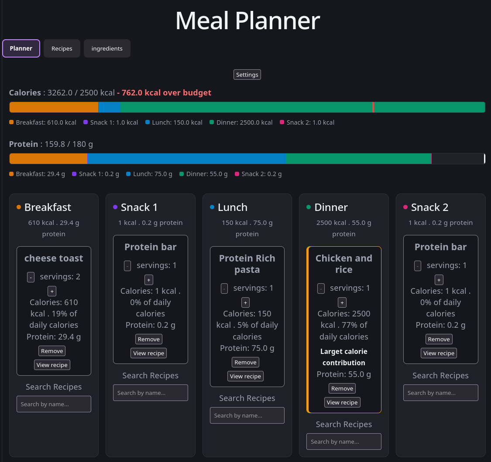

# Meal planner App 

A small web app to ease planning of meal plans and catalogue recipes.



## How to run it

Requires Docker and Docker Compose. Tested on Linux.

Run these commands from the repository root. On Linux, prefix Docker
commands with `sudo` if your setup requires it.

Create the database volume once:

```sh
docker volume create mealplanner-data
```

Build and start:

```sh
docker compose up -d --build
```

Open http://localhost:8080.

The database is stored in the Docker volume and persists when the
container is stopped or replaced. Daily nutrition targets stay in
your browser.

Stop:

```sh
docker compose down
```

View logs:

```sh
docker compose logs -f
```
```
```
